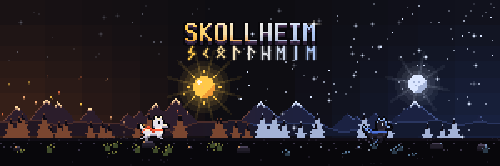

  

  <b>Independent studio: video games on Steam, websites and apps.</b>

  <a href="https://skollheim.com">skollheim.com</a> ·
  <a href="https://store.steampowered.com/developer/skollheim">Steam</a> ·
  <a href="https://www.youtube.com/@skollheimgames">YouTube</a> ·
  <a href="https://x.com/skollheim">X</a> ·
  <a href="https://www.tiktok.com/@skollheim">TikTok</a> ·
  <a href="https://www.instagram.com/skollhe.im/">Instagram</a>

In Norse myth, Sköll is the wolf who chases the sun across the sky, and his brother Hati chases the moon. Our games share their stubbornness: one more run, one more upgrade, a little further each time.

### Games

| Game | |
| --- | --- |
| [**Bone Idle**](https://store.steampowered.com/app/5221700/Bone_Idle/) | Put the dead to work. Out now on Steam. |
| [**Mining Miner**](https://store.steampowered.com/app/2303330/Mining_Miner/) | 3,000 metres of rock under your feet. Early Access on Steam. Made with [MTSU](https://mtsu.dev) ([GitHub](https://github.com/mtsu-dev)). |

### Open source

| Repository | |
| --- | --- |
| [**bots**](https://github.com/Skollheim/bots) | Bots, the desktop companion for Boite: little robots on your desktop that watch and talk to your agents. |
| [**SkinCapital**](https://github.com/Skollheim/SkinCapital) | CS2 skin portfolio tracker: inventory, Steam, CSFloat and Skinport prices, profit and loss, alerts. |

### Contact

contact@skollheim.com
